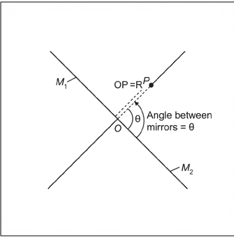
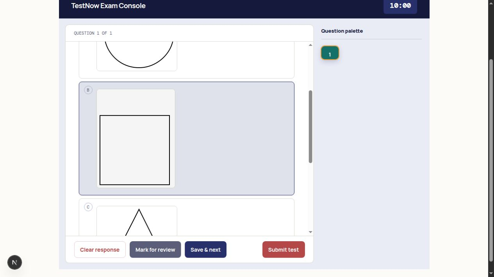

# Diagram extraction fix and verification

15 October 2026. Implemented locally; no production bank migration or deployment was performed. See [the initial audit](diagram-extraction-audit.md) for the original failures.

## What changed

The fix covers PDF and DOCX inputs, stem figures, image-only answer choices, mixed text/image options, and solution figures. It keeps the existing Celery, database, storage, batching, checkpoints, and scoring architecture. Figure ownership and validation now have one implementation in `apps/api/app/figures.py`.

| Failure | Change |
| --- | --- |
| Page backgrounds, borders, and text fragments become diagrams | Exclude background/off-page paths, require bounded regions and actual rendered ink, check graphics evidence and excessive prose, and flag uncertain content. |
| Thin-line figures break into fragments or disappear | Group connected strokes before filtering complete figure size; merge bridging components transitively and include nearby labels. |
| Pixel coordinates and PDF points get mixed | Declare unrotated page geometry and explicitly convert model coordinates to canonical PDF points. Persist the final rendered box. |
| Gemini identifies figures but gives an incomplete question span | Locate the printed question using native text and matching stem words, then ground its scope in the page layout. Respect detected question columns and flag conflicting ownership. |
| A figure is assigned to several questions | Require containment rather than incidental intersection; detect conflicting question scopes and duplicate figure ownership. |
| Diagrams are the answer options but appear under the stem | Persist `role: option` plus zero-based `option_index`; render the figure inside its choice in both review and exam screens. Preserve empty option text and printed option order. |
| Some visual options are silently missing | Retain `requires_diagram` through normalization, validate every expected choice, and recover contiguous explicit option owners when option records were omitted. Recovered/ambiguous records require review. |
| A model omits an otherwise detected graphic | Flag the unclaimed native candidate rather than silently dropping it or inventing stem ownership. |
| Successful PNG encoding allows invalid content to be approved | Separate content/geometry validation from rendering. Missing or partly failed figures and storage failures create explicit review issues. Generic approval cannot clear visual issues. |
| DOCX conversion loses geometry on a later retry | Persist and reuse the canonical converted PDF. Inspect the original Word drawing inventory; complex or missing converted graphics require review. |
| Old repair scripts recreate bad crops | Teacher imports, bank imports, model seeds, native seeds, solution mapping, and repair paths use the shared figure logic. Whole-question native seed screenshots are audit previews rather than diagram entries. |
| Repair changes images in previously saved tests | Use immutable image keys and resolve media against the saved test's recorded asset key, with access checks. |

No database schema migration is needed: the additional role, owner, provenance, and review fields use the existing JSON columns. Legacy figures with no role still display as stem figures until explicitly repaired.

## Gemini 3.1 Flash-Lite

Gemini remains the extractor through OpenRouter. Repository defaults, Compose defaults, the environment example, and the local model setting now select `google/gemini-3.1-flash-lite`. An explicitly configured fallback remains supported, with its own coordinate contract.

The Gemini request schema uses `box_2d: [ymin, xmin, ymax, xmax]`, normalized to 0–1000. The server converts that declared format into PDF points. It does not guess units based on the numerical values. Other models retain the PDF-point schema. Native text, page dimensions, text block boxes, candidate graphics, and selected page images are supplied together. Text-rich pages with graphics and continuation pages receive visual input too.

This uses the documented [Gemini image-understanding coordinate convention](https://ai.google.dev/gemini-api/docs/image-understanding) and [OpenRouter structured-output support](https://openrouter.ai/google/gemini-3.1-flash-lite). It does not assume that model confidence alone proves a crop is correct.

## Verification

Two real OpenRouter/Gemini probes were run without saving questions to production:

- **Four diagram-only options:** Gemini recognized all four choices, but its source span omitted the right column and lower row. Native question grounding and graphic matching recovered exactly four figures, owned by option indices 0–3, without duplicate images. That real response is retained as a regression fixture.
- **The existing optics PDF:** native detection originally generated 12 page-sized false vector figures, one on each page. It now returns the three embedded raster figures. A live extraction of primary pages 1–2 with continuation context returned no figures for questions 1–3 and one intact stem figure for question 4, with no diagram validation issues.

The DOCX integration test constructs two image-only choices and runs the real LibreOffice conversion, image detection, crop validation, and option association. Both survive with correct ownership.

The regression suite covers invalid/negative/zero pages, non-finite and malformed boxes, blank/text crops, thin strokes, labels, duplicate/conflicting owners, question columns, incomplete visual choices, missing option records, source grounding, rotated pages, continuation pages, upload failures, conversion warnings, checkpoints, approval gates, manual repair, draft choice recovery, and test snapshot media access.

The isolated browser fixture used the actual question and figure-editor components with a fixture API. It verified images inside selectable exam choices, selecting option B, removing/redrawing a crop, saving its owner, and restoring omitted visual choice records. Backend persistence and access checks were tested separately against SQLite.

Final check commands:

```bash
PYTHONPATH=apps/api .venv/bin/python -m pytest apps/api/tests -q --tb=short
npm run build:web
git diff --check
```

Validation result: **75 figure/extraction tests passed**. The full backend suite finished with **88 passed and one pre-existing failure**, `test_expired_attempt_cannot_be_submitted`, caused by comparing SQLite's timezone-naive datetime with a timezone-aware datetime. The same failure was reproduced from an untouched `git archive HEAD` copy. It is separate from extraction. The production web build, Python compilation, and whitespace checks pass. A separate cropped-and-rotated-page probe also preserved geometry and restored the original page rotation.

Verified PDF crop:



Verified selectable diagram option in the browser fixture:



## Correcting an existing question

In teacher review or the bank question's Rendered tab, open **Review / correct figures**. Inspect the source page, remove bad boxes, draw complete figures with labels, and select Question, Option A/B/etc., or Worked solution as their owner. Confirm the figure set, save it, and then approve the question separately.

If visual choices were not recognized at all, use **Add visual answer choices** first. This stages the question and clears an incompatible old answer so a reviewed choice answer can be selected. The bank Edit tab also has **Save draft**, allowing choice definitions to be corrected before image approval. Existing saved tests keep their original content and assets.

## Auditing and repairing a bank

Run these with the API's normal database and object-store configuration. The first command is read-only for the bank and writes local previews plus a JSON report:

```bash
python -m app.figure_repairs --bank-id BANK_ID \
  --report /tmp/figure-audit.json
```

It audits up to 100 questions by default. Use `--limit` to set the scope or repeat `--question-id` to select specific records. Inspect the proposals before applying a bounded set:

```bash
python -m app.figure_repairs --bank-id BANK_ID --question-id QUESTION_ID \
  --apply --report /tmp/figure-repair.json
```

Apply writes new assets and stages changed questions for review. It preserves question IDs, text, options, answers, original source spans, solution figures, and old assets; it never auto-approves replacements. It does not call an extraction model. Missing or structurally incorrect choice definitions must be corrected in review or re-extracted from the source.

Deploy/restart both API and workers together with the updated web application. A code deployment fixes future imports; existing stored crops need the audit/repair or review workflow. There is no automatic production rewrite in this change.

## Practical limits

No finite test set establishes perfect extraction for every document. Scans, OCR layers over full-page images, ambiguous layouts, unsupported Word graphics, and uncertain figure/option ownership are kept in review instead of being silently accepted. A reviewer can make a source-backed crop even when native graphics detection cannot describe its contents. Blank images and invalid geometry remain rejected.

For Word graphics absent from the converted preview, compare with the original document and supply a PDF exported from Word; a downstream crop cannot reconstruct content lost during conversion. The original anomalous production corpus was not available locally, so this change is supported by the local PDF, controlled DOCX cases, synthetic failure fixtures, real Gemini responses, browser checks, and regression tests—not a claim that every historical production record has already been repaired.
